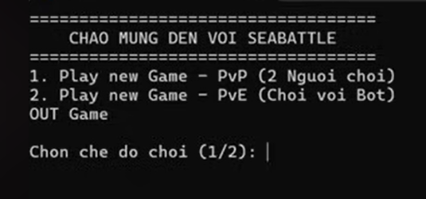
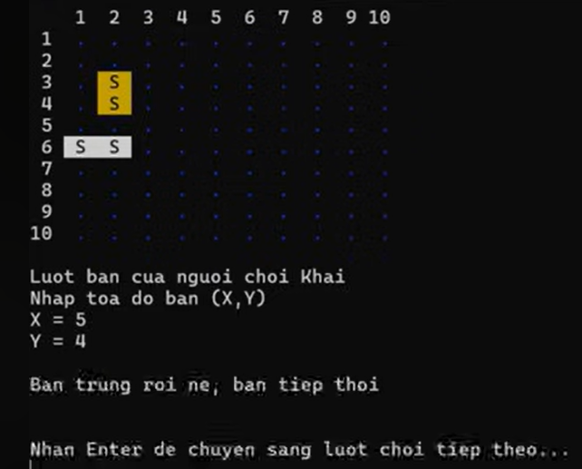
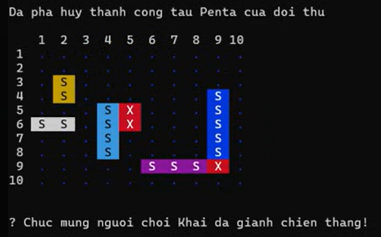
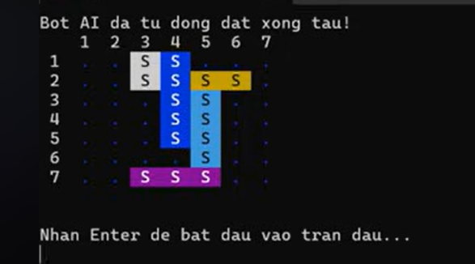
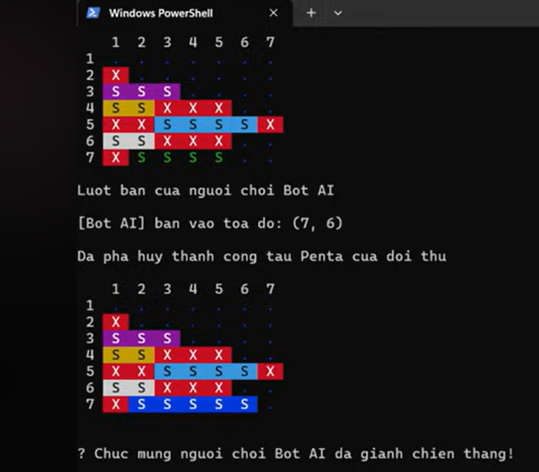

# Sea Battle

Sea Battle is a game for two players. The game is played on four grids, two for each player. The grids are typically square – usually 10×10 – and the individual squares in the grid are identified by letter and number. On one grid the player arranges ships and records the shots by the opponent. On the other grid the player records their own shots.

This project was developed by [Đàm Thuận Khải](https://github.com/tkai-better) as a mid-term assignment for the Java Core (OOP) course at [ProPTIT](https://proptit.com/).


## Tech Stack

- [Java](https://www.java.com/en/) 


## Installation

- Clone the repository.
- Open the project in your preferred IDE (IntelliJ IDEA, Eclipse, VS Code).
- Run the main class to start the game.


## Gameplay Demo
[Video demo Game](https://www.youtube.com/watch?v=GEj6VnqgAM0)

## Images:











## Usage

- Project Structure
*Note: This is a suggested project structure. You are free to modify and organize the packages according to your own Object-Oriented design.*

```bash
├── src
│   ├── SeaBattle
│   │   ├── Controller
│   │   │   └── GameManager.java
│   │   │   
│   │   ├── Model
│   │   │   ├── Board.java
│   │   │   ├── Ceil.java
│   │   │   ├── Ship.java
│   │   │   ├── ShipType.java
│   │   │   ├── BotPlayer.java
│   │   │   └── Player.java
│   │   │   
│   │   ├── View
│   │   │   ├── View.java
│   │   │   └── Input.java
```

## Contributing

Pull requests are welcome. For major changes, please open an issue first to discuss what you would like to change.

Please make sure to update tests as appropriate.

## License

[MIT](https://choosealicense.com/licenses/mit/)